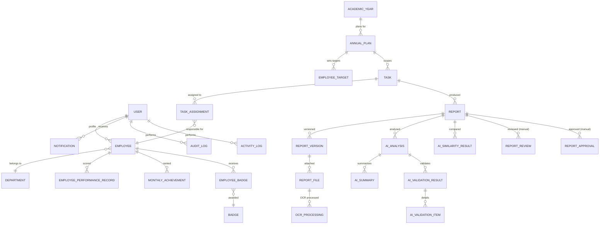
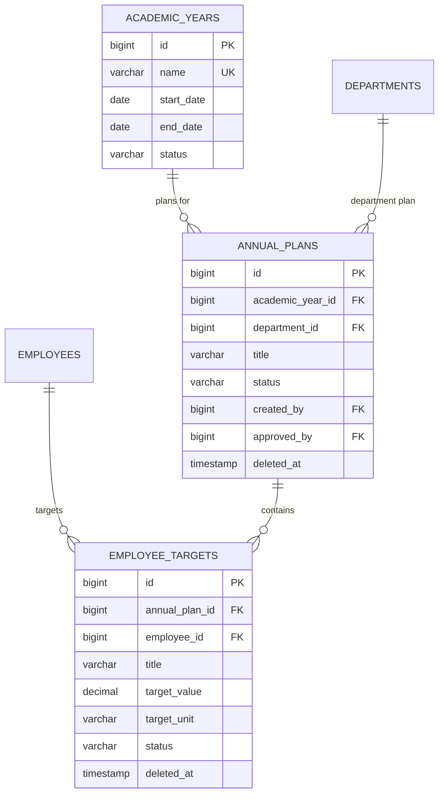
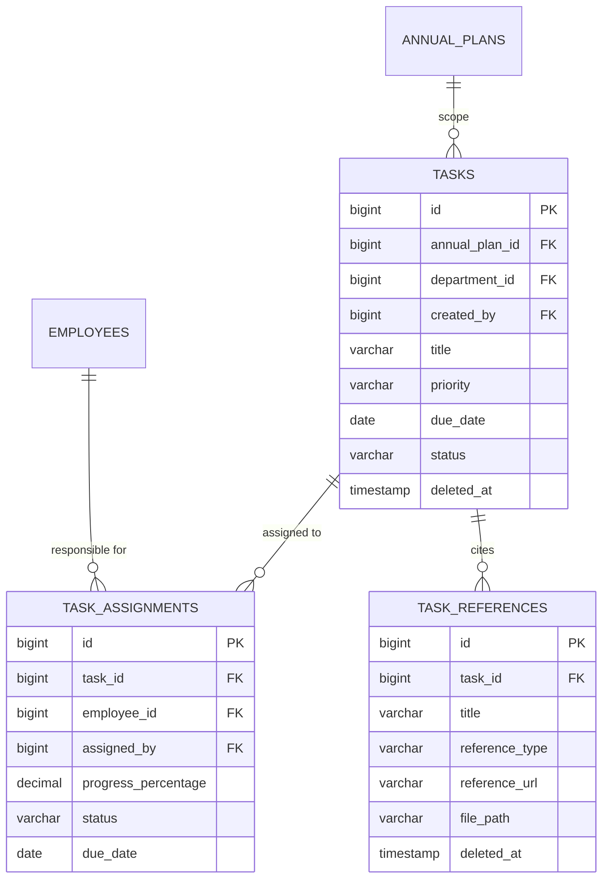
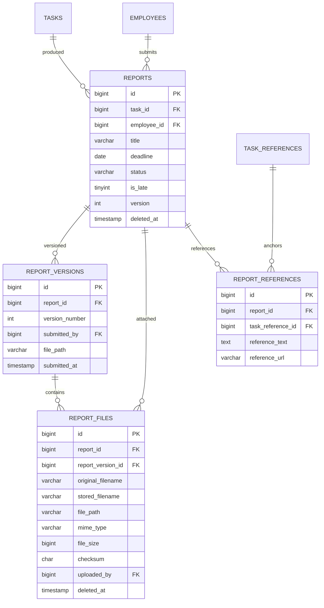
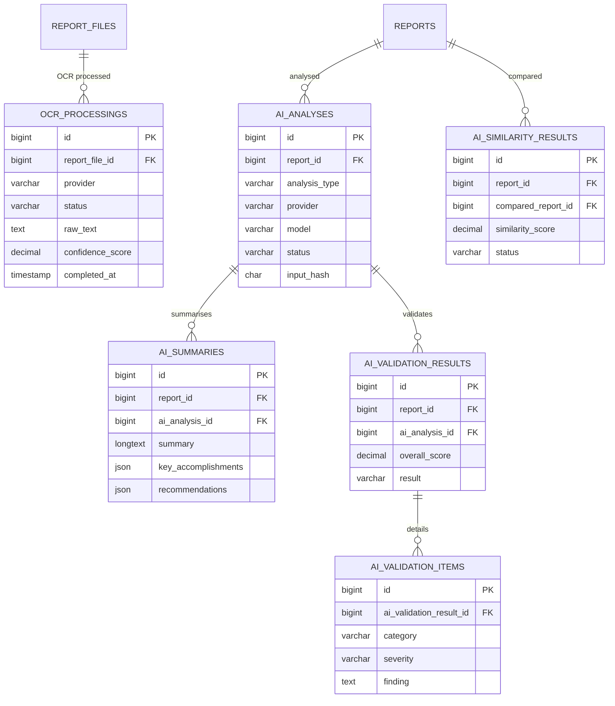
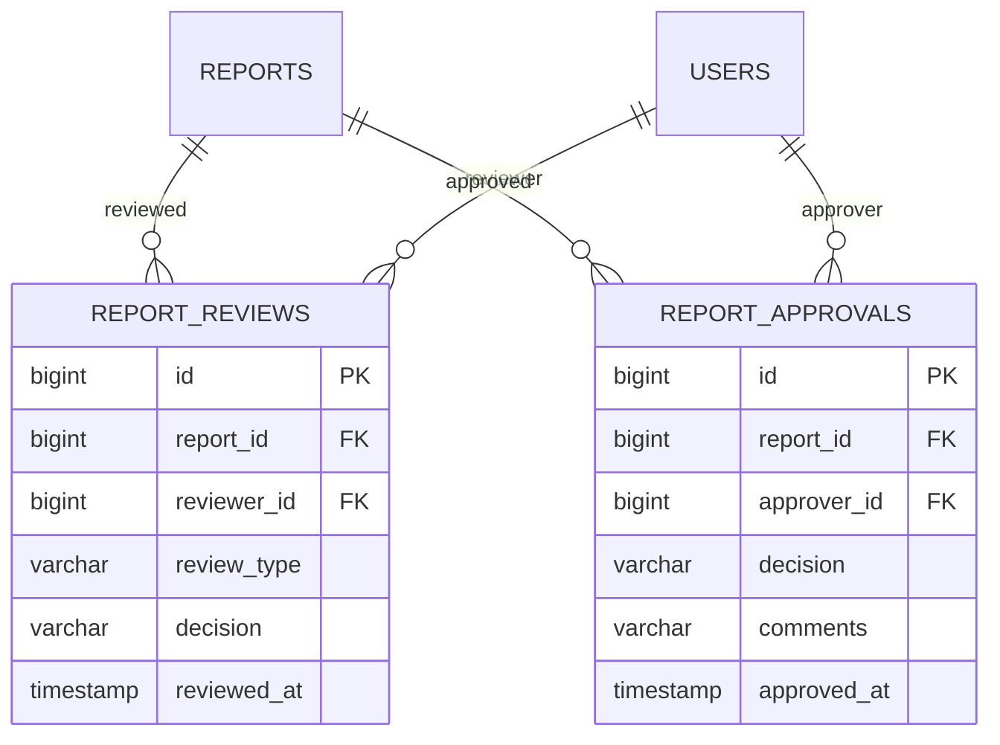
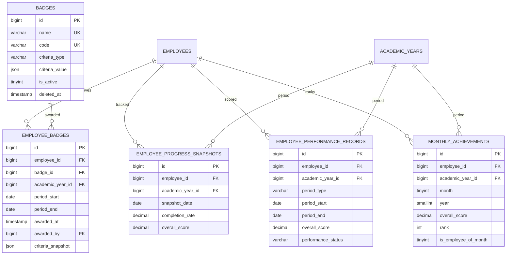
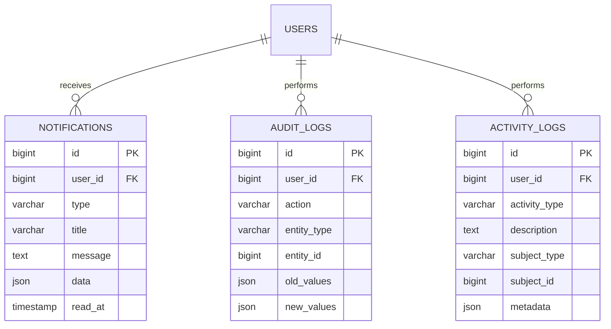

# JPC Portal — Entity-Relationship Diagram (Phase 3.1)

> Designed in **Phase 3.1-A** as the relational architecture reference for
> **Phase 3.1-B — Laravel Migrations**, and verified against the live schema in
> **Phase 3.1-E — Database Foundation Finalization**.
>
> Open with a Mermaid-capable renderer (VS Code Mermaid extension, GitHub, etc.).

## Major architecture (overview)



## Grouped ERD — Core Relationships

```mermaid
erDiagram
    USERS {
        bigint id PK
        varchar name
        varchar email UK
        varchar status
        timestamp last_login_at
    }
    ROLES {
        bigint id PK
        varchar name UK
        varchar display_name
    }
    PERMISSIONS {
        bigint id PK
        varchar name UK
        varchar display_name
    }
    ROLE_USER {
        bigint role_id FK
        bigint user_id FK
    }
    PERMISSION_ROLE {
        bigint permission_id FK
        bigint role_id FK
    }
    USERS ||--o{ ROLE_USER : "has roles"
    ROLES ||--o{ ROLE_USER : "assigned to"
    ROLES ||--o{ PERMISSION_ROLE : "grants"
    PERMISSIONS ||--o{ PERMISSION_ROLE : "assigned to"

    DEPARTMENTS {
        bigint id PK
        varchar name UK
        varchar code UK
        varchar status
        timestamp deleted_at
    }
    POSITIONS {
        bigint id PK
        varchar name UK
        varchar code UK
        varchar status
        timestamp deleted_at
    }
    EMPLOYEES {
        bigint id PK
        bigint user_id FK UK
        varchar employee_number UK
        varchar first_name
        varchar last_name
        bigint department_id FK
        bigint position_id FK
        varchar employment_status
        timestamp deleted_at
    }
    DEPARTMENT_HEADS {
        bigint id PK
        bigint department_id FK
        bigint employee_id FK
        date start_date
        date end_date
        tinyint is_current
        bigint current_department_id generated UK
    }
    DEPARTMENTS ||--o{ EMPLOYEES : "contains"
    POSITIONS ||--o{ EMPLOYEES : "holds"
    USERS ||--o{ EMPLOYEES : "has profile"
    DEPARTMENTS ||--o{ DEPARTMENT_HEADS : "led by"
    EMPLOYEES ||--o{ DEPARTMENT_HEADS : "head of"
```

## Academic Year & Planning



## Task Management



## Report Management



## OCR & AI Processing



## Manual Review & Approval



## Performance & Achievements



## Notifications & Audit



## Phase 4–9 Additions (Workflow, AI Chat, Data Quality, Reporting)

```mermaid
erDiagram
    REPORT ||--o{ REPORT_REVIEW_COMMENT : "comments"
    REPORT ||--o{ REPORT_TIMELINE : "timeline"
    REPORT_VERSION ||--o{ REPORT_FILE : "contains"
    REPORT ||--o{ AI_FINDING : "finds"
    REPORT ||--o{ AI_INSIGHT : "insights"

    USERS ||--o{ AI_CHAT_CONVERSATION : "opens"
    AI_CHAT_CONVERSATION ||--o{ AI_CHAT_MESSAGE : "contains"
    AI_CHAT_MESSAGE ||--o{ AI_CHAT_TOOL_CALL : "invokes"

    EMPLOYEE_PERFORMANCE_RECORD ||--o{ PERFORMANCE_SCORE_BREAKDOWN : "broken down"
    PERFORMANCE_PERIODS ||--o{ EMPLOYEE_PERFORMANCE_RECORD : "period"

    DATA_QUALITY_SCAN ||--o{ DATA_QUALITY_ISSUE : "finds"
    DATA_QUALITY_ISSUE ||--o{ DATA_QUALITY_ISSUE_HISTORY : "history"
    USER ||--o{ REPORT_EXPORT : "requests"
    DEPARTMENT ||--o{ DEPARTMENT_PLAN : "plans"
    ANNUAL_PLAN ||--o{ DEPARTMENT_PLAN : "scopes"
    DEPARTMENT ||--o{ DEPARTMENT_TARGET : "targets"
    DEPARTMENT_PLAN ||--o{ DEPARTMENT_TARGET : "contains"
    EMPLOYEE_TARGET }o--|| DEPARTMENT_TARGET : "may derive"

    TASK_ASSIGNMENT ||--o{ TASK_PROGRESS : "progress trail"
    TASK_ASSIGNMENT ||--o{ TASK_REVIEW : "reviewed"
    TASK ||--o{ TASK_COMMENT : "discussed"
    TASK ||--o{ TASK_ATTACHMENT : "attached"

    USERS ||--o{ NOTIFICATION_PREFERENCE : "routing"
    NOTIFICATIONS ||--o{ NOTIFICATION_LOG : "delivery trace"
    USER ||--o{ MESSAGE : "sends/receives"
    USER ||--o{ ANNOUNCEMENT : "author of"
    DEPARTMENT ||--o{ DEPARTMENT_ESCALATION : "escalates"
```



## Legend

| Symbol | Meaning |
| ------ | ------- |
| PK     | Primary key |
| UK     | Unique key |
| FK     | Foreign key |
| `\|\|--o{` | One-to-many |
| `generated` | Computed stored column |

Entity-type FKs (audit_logs.entity_type, activity_logs.subject_type) are polymorphic
logical references and intentionally have no formal foreign key constraint.

> The diagrams above document the design reference. The authoritative live schema is
> produced by `backend/database/migrations/*.php`; see also
> [`../DATABASE.md`](../DATABASE.md) for per-table documentation.
